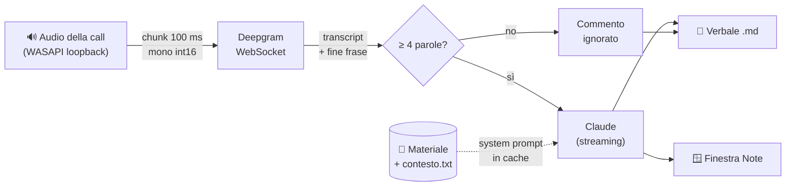

<div align="center">

# 🎙️ Assistente per l'orale

**Ascolta il docente in videochiamata, trascrive la domanda e ti mostra una risposta in pochi secondi, basata sul tuo materiale.**


</div>

---

## Indice

- [Cosa fa](#cosa-fa)
- [Come funziona](#come-funziona)
- [Requisiti](#requisiti)
- [Installazione](#installazione)
- [Configurazione](#configurazione)
- [Uso](#uso)
- [Verbale e appunti della sessione](#verbale-e-appunti-della-sessione)
- [Durante una presentazione](#durante-una-presentazione)
- [Risoluzione problemi](#risoluzione-problemi)
- [Struttura del progetto](#struttura-del-progetto)

---

## Cosa fa

| | |
|---|---|
| 🔊 **Ascolta solo il docente** | Cattura l'audio di sistema di Windows (WASAPI loopback), non il tuo microfono: mentre parli tu non succede nulla. |
| ✍️ **Trascrive in streaming** | Deepgram Nova-2 via WebSocket, con anteprima della domanda mentre arriva. Supporta varianti d'accento (es. inglese indiano) e termini tecnici personalizzati. |
| 🧠 **Risponde col tuo materiale** | Legge all'avvio una cartella con soluzioni, notebook, PDF e codice, e Claude risponde citando le tue scelte e i tuoi numeri reali. |
| ⚡ **Bassa latenza** | Prima riga di risposta in ~1–3 s dalla fine della domanda, in streaming in una finestra sempre in primo piano. |
| 🧩 **Capisce le domande spezzate** | Se il docente fa una pausa a metà domanda, i pezzi vengono uniti; i commenti brevi ("Okay", "Go on") sono ignorati. |
| 📝 **Prende appunti** | Ogni sessione viene salvata in un file Markdown; alla chiusura Claude la identifica, la titola e scrive cosa ripassare. |
| 💳 **Gratis con Claude Pro** | Senza chiave API usa Claude Code con il tuo abbonamento; con la chiave API è ancora più veloce. |

---

## Come funziona



1. **Cattura**: PyAudioWPatch apre il loopback del dispositivo di uscita predefinito, converte in mono e passa chunk da ~100 ms a un `asyncio.Queue` senza bloccare il callback audio.
2. **Trascrizione**: i chunk vanno a Deepgram (`nova-2`, `interim_results`, `endpointing=900`, `utterance_end_ms=1500`). Il loopback tace nel silenzio, quindi il programma invia qualche secondo di silenzio sintetico per far rilevare la fine della frase, poi `KeepAlive`. Riconnessione automatica.
3. **Fine domanda**: alla chiusura della frase (`speech_final` o `UtteranceEnd`) la domanda parte verso Claude. Una nuova domanda abbandona la risposta in corso.
4. **Risposta**: Claude Haiku riceve il tuo materiale come system prompt in cache e gli ultimi 3 scambi come contesto. Con l'abbonamento, un processo `claude` viene avviato in anticipo così il tempo di avvio non pesa.
5. **Interfaccia**: tkinter, aggiornata solo dal thread principale tramite coda e `root.after(50)`.

---

## Requisiti

- **Windows 10/11** con **Python 3.10+** nativo (non WSL)
- Una chiave **Deepgram** (gratuita con il credito iniziale): [console.deepgram.com](https://console.deepgram.com) → *API Keys*
- Per le risposte, una delle due:
  - **Claude Pro/Max** con [Claude Code](https://claude.com/claude-code) installato e collegato (`claude auth login`), **oppure**
  - una chiave **Anthropic API**: [console.anthropic.com](https://console.anthropic.com) → *API Keys* (a consumo, pochi centesimi a sessione)

---

## Installazione

```powershell
git clone <url-del-repository> assistente-orale
cd assistente-orale
python -m venv .venv
.\.venv\Scripts\python.exe -m pip install -r requirements.txt
copy .env.example .env
```

Poi apri `.env` con il Blocco note e inserisci almeno `DEEPGRAM_API_KEY`.

Se usi l'abbonamento Claude, collega Claude Code una volta sola:

```powershell
claude auth login
```

---

## Configurazione

Tutto si imposta nel file **`.env`** (ignorato da git) oppure come variabili d'ambiente Windows (`setx NOME "valore"`, poi riapri il terminale). Le variabili d'ambiente hanno la precedenza.

| Variabile | Obbligatoria | Descrizione |
|---|:---:|---|
| `DEEPGRAM_API_KEY` | ✅ | Chiave per la trascrizione |
| `ANTHROPIC_API_KEY` | | Se presente usa l'API (più veloce); se assente usa Claude Code con l'abbonamento |
| `LINGUA` | | `en` (default) o `it`: lingua di trascrizione e risposte |
| `DEEPGRAM_LINGUA` | | Variante d'accento, es. `en-IN`, `en-GB` |
| `CARTELLA_SOLUZIONI` | | Cartella con il materiale da discutere |

**File di supporto**

| File | A cosa serve |
|---|---|
| `contesto.txt` | Testo libero aggiunto al contesto (esercizio, teoria, scelte, limiti). Le righe con `#` sono ignorate. |
| `parole_chiave.txt` | Termini tecnici, uno per riga (max 100): Deepgram li riconosce meglio. |

**Cartella del materiale**: vengono letti, anche nelle sottocartelle, notebook `.ipynb` (codice, testo e output), `.pdf`, `.py`, `.md`, `.txt` e i principali file di codice. Cartelle come `.venv`, `.git` e `__pycache__` sono saltate. Limite totale circa 100k token: metti solo ciò che serve.

---

## Uso

> 💡 Il modo più semplice: **doppio clic su `avvia.bat`**.

```powershell
.\.venv\Scripts\python.exe assistente.py
```

Prima di iniziare aspetta in console la riga `Materiale caricato nella cache di Claude`: da lì le risposte sono già veloci.

**Opzioni**

| Comando | Cosa fa |
|---|---|
| `--cartella "C:\percorso"` | Usa questa cartella di materiale (al posto di `CARTELLA_SOLUZIONI`) |
| `--lingua it` | Orale in italiano |
| `--abbonamento` | Forza Claude Code anche se c'è una chiave API |
| `--lista-dispositivi` | Mostra i dispositivi audio e quale loopback verrà usato |
| `--debug-audio` | Stampa il volume RMS ogni secondo (verifica che il loopback senta la call) |
| `--test-domanda "testo"` | Manda subito una domanda a Claude, senza audio |
| `--test-wav file.wav` | Usa un WAV PCM 16 bit al posto del loopback, a velocità reale |
| `--riassumi file.md` | Rigenera titolo e appunti di un verbale già salvato |
| `--senza-verbale` | Non salva il verbale della sessione |

**Tasti nella finestra**

| Tasto | Azione |
|---|---|
| <kbd>Esc</kbd> | Chiude (salvando prima gli appunti; premi di nuovo per uscire subito) |
| <kbd>Ctrl</kbd> + <kbd>↑</kbd> / <kbd>↓</kbd> | Ingrandisce / rimpicciolisce il testo |
| <kbd>F5</kbd> | Riavvia la cattura audio (dopo un cambio di cuffie o casse) |

---

## Verbale e appunti della sessione

Ogni avvio crea `sessioni\sessione_<data>_<ora>.md` e ci scrive **in tempo reale** domande, commenti brevi e risposte suggerite: se il programma si chiude male, quanto già successo resta salvato.

Alla chiusura con <kbd>Esc</kbd>, Claude rilegge il verbale e aggiunge in cima:

- un **titolo** che identifica la sessione (il file viene rinominato di conseguenza);
- quali esercizi o lab sono stati discussi, con i **file del materiale** a cui si riferiscono;
- le **domande del docente** riformulate, ciascuna con il punto chiave della risposta;
- **punti deboli e cose da ripassare**.

---

## Durante una presentazione

- **Lascialo acceso per tutto l'orale.** In videochiamata la tua voce non torna alle tue casse, quindi mentre esponi il programma non sente nulla e non reagisce.
- **Non emette suoni** e non invia nulla nella call: si limita ad ascoltare.
- **Condividi solo la finestra** della presentazione, non lo schermo intero: la finestra *Note* è sempre in primo piano. Su Zoom: *Condividi schermo* → scheda *Di base* → scegli la miniatura della finestra.
- **Chiudi ogni altra fonte audio** (video, musica, notifiche): il loopback sente tutto ciò che esce dalle casse.

---

## Risoluzione problemi

<details>
<summary><b>Il loopback non sente nulla</b></summary>

- Lancia `--lista-dispositivi`: il loopback usato deve corrispondere a dove senti la call.
- Lancia `--debug-audio` e fai partire un video: i valori RMS devono salire. "Nessun dato" è normale quando nessuna app riproduce audio.
- Nell'app della call l'uscita deve essere il dispositivo predefinito di Windows (*Impostazioni → Sistema → Audio*).
- Cuffie Bluetooth: in modalità "vivavoce" il dispositivo cambia nome; imposta come predefinito quello giusto.
</details>

<details>
<summary><b>Il dispositivo audio cambia durante la call</b></summary>

Premi <kbd>F5</kbd>: il loopback viene riaperto sul nuovo dispositivo predefinito e la connessione a Deepgram ripristinata.
</details>

<details>
<summary><b>La risposta arriva in ritardo</b></summary>

- La riga di stato mostra il tempo tra fine domanda e prima riga di risposta.
- Con l'abbonamento la prima riga arriva in genere in 1–3 s, a volte fino a 5 s; con la chiave API è più veloce e costante (~1 s).
- Aspetta il messaggio "Materiale caricato nella cache" prima di iniziare.
- Riduci il materiale ai soli file utili e chiudi download o streaming in background.
</details>

<details>
<summary><b>Compaiono domande che il docente non ha detto</b></summary>

Il loopback sente qualsiasi audio del PC: chiudi video, musica, altre schede e attiva *Non disturbare*.
</details>

<details>
<summary><b>Trascrizione imprecisa con accenti marcati</b></summary>

Imposta `DEEPGRAM_LINGUA` sulla variante giusta (es. `en-IN`) e aggiungi i termini del corso in `parole_chiave.txt`.
</details>

<details>
<summary><b>Gli appunti di fine sessione non sono stati creati</b></summary>

La cronologia è comunque salvata. Rigenera gli appunti con:

```powershell
.\.venv\Scripts\python.exe assistente.py --riassumi "sessioni\sessione_....md"
```
</details>

---

## Struttura del progetto

```
├── assistente.py       # pipeline: audio, Deepgram, Claude, verbale, opzioni
├── ui.py               # finestra "Note" (tkinter)
├── avvia.bat           # avvio con doppio clic
├── contesto.txt        # contesto libero aggiunto al prompt
├── parole_chiave.txt   # termini tecnici per la trascrizione
├── requirements.txt
├── .env.example        # modello di configurazione
└── sessioni/           # verbali .md (non versionati)
```

---

<div align="center">
<sub>Le chiavi API restano solo nel tuo <code>.env</code> locale, ignorato da git, così come i verbali delle sessioni.</sub>
</div>
